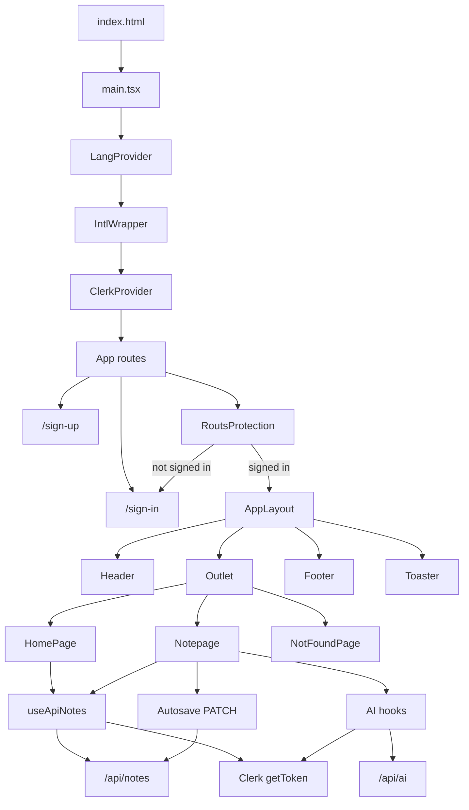

# Frontend architecture

This document describes the frontend as it is implemented in `frontend/`. It is a Vite + React + TypeScript single-page app. Styling uses Tailwind CSS. Routing uses React Router. Authentication uses Clerk. Copy uses `react-intl` with English and Arabic message files.

The API base URL is `VITE_API_URL`, or `http://localhost:3001` when that variable is missing. Authenticated requests send `Authorization: Bearer <token>` from Clerk's `getToken()`.

## Folder structure

```text
frontend/
  index.html                 # mounts #root and loads /src/main.tsx
  vite.config.ts             # React + Tailwind plugins; "@" aliases to src/
  package.json
  src/
    main.tsx                 # app entry: language, intl, Clerk, then App
    index.css
    app/
      App.tsx                # routes
      types/index.ts         # Note and AI request/response types
      layout/                # shell used by signed-in pages
      pages/                 # route screens
    components/
      common/                # shared app components
      note/                  # note-specific UI
      ui/                    # reusable controls (button, input, dialog, badge)
    hooks/                   # notes API, AI API, language context
    i18n/                    # locale messages and language provider
    Context/                 # LangContext value type
    lib/utils.ts             # className helper and text direction
```

| Path | Purpose |
| --- | --- |
| `src/app` | Router, page screens, layout, and shared TypeScript types. |
| `src/app/layout` | Signed-in shell: header, toast host, page outlet, footer. |
| `src/app/pages` | Home, note editor, sign-in, sign-up, and not-found screens. |
| `src/components/common` | Route guard, intl wrapper, glass card, delete dialog, loading skeleton. |
| `src/components/note` | Autosave status badge. |
| `src/components/ui` | Presentational controls used by pages. `AppLayout` imports `Toaster` from `sonner` directly; `components/ui/sonner.tsx` is a themed wrapper and is not the one mounted in the layout. |
| `src/hooks` | Data access and language context. |
| `src/i18n` | `en.json`, `ar.json`, locale constants, and `LangProvider`. |
| `src/Context` | Type of the language context value. |
| `src/lib` | `cn()` for Tailwind class merging, and `detectTextDirection()` for the note body. |

## Entry point

`index.html` loads `src/main.tsx`. That file renders into `#root` in this order:

1. `StrictMode`
2. `LangProvider` — current locale, RTL flag, and language toggle
3. `IntlWrapper` — `react-intl` `IntlProvider` using the active locale's messages
4. `ClerkProvider` — requires `VITE_CLERK_PUBLISHABLE_KEY`; throws if it is missing
5. `App`

## Routing

`App` uses `BrowserRouter`. Sign-in and sign-up sit outside the app shell. Every other route is wrapped by `RoutsProtection` and `AppLayout`.

| Path | Screen | Guard |
| --- | --- | --- |
| `/sign-in` | `SignInPage` | none |
| `/sign-up` | `SignUpPage` | none |
| `/` | `HomePage` | signed in |
| `/notes/:id` | `Notepage` | signed in |
| any other path | `NotFoundPage` | signed in |

`RoutsProtection` reads Clerk's `isLoaded` and `isSignedIn`. While Clerk is loading it shows a spinner. If the user is not signed in it redirects to `/sign-in`. Signed-in users see `AppLayout`, and React Router renders the matched page in `<Outlet />`.

`AppLayout` sets `dir` from the language context (`rtl` when Arabic, otherwise `ltr`), then renders `Header`, the Sonner `Toaster`, `<main><Outlet /></main>`, and `Footer`. The toaster is mounted once so any signed-in page can call `toast.success` or `toast.error`.

## Pages and layout

### Header

Brand link to `/`, a short tagline (hidden below the `md` breakpoint), a button that calls `toggleLang()`, and Clerk's `UserButton` for the account menu.

### Footer

Copyright line (current year) and a link to the GitHub profile.

### Home (`HomePage`)

On mount it calls `getAllUserNote()` and stores the returned array. An empty list shows an empty state and a create button. A non-empty list shows a create button, a search field, and a grid of note titles.

Creating a note posts a title and content taken from the current locale (`home.newNoteTitle`, `home.newNoteContent`). On success the app navigates to `/notes/:id` with router state `{ justCreated: true }`. Clicking a card navigates to that note without that state.

The search input is rendered and localized. It has no state and does not filter the list.

### Note editor (`Notepage`)

Loads one note with `getNoteById(id)` after Clerk has loaded. If the fetch returns nothing, it shows an error toast and returns home. While loading, or before a note is in state, it renders `Skeleton`. When the user just created the note, loading waits at least three seconds before showing the editor.

The screen has:

- Back, which goes to `/`
- Summarize, Translate, and a Mode menu (comedy, formal, casual)
- Autosave badge and a delete confirmation dialog
- Title input and content textarea

The textarea `dir` comes from `detectTextDirection(note.content)`: Arabic characters in the body switch that field to RTL.

### Sign-in and sign-up

`SignInPage` renders Clerk's `<SignIn />` inside a glass card. `SignUpPage` renders Clerk's `<SignUp />` centered on the page. Neither uses `AppLayout`.

### Not found

`NotFoundPage` shows a localized message and a link back to `/`. It is only reachable inside the signed-in layout.

## Custom hooks

### `useLang` (`hooks/useLang.tsx`)

Reads `LangContext`. Throws if it is used outside `LangProvider`. Returns `locale`, `setLocale`, `RTL`, and `toggleLang`.

### `useGetAllNotes` (`hooks/useApiNotes.tsx`)

Default export. `Notepage` imports the same function as `useApiNotes`. Every call gets a Clerk token first. Missing token returns an empty list, `null`, or skips the request.

| Function | Request | Returns |
| --- | --- | --- |
| `getAllUserNote` | `GET /api/notes` | `notes` array, or `[]` on failure |
| `createnote` | `POST /api/notes` with `{ title, content }` | created `note`, or `null` |
| `getNoteById` | `GET /api/notes/:id` | `note` from the JSON body |
| `updateNote` | `PATCH /api/notes/:id` with `{ title?, content? }` | `note` from the JSON body |
| `deleteNote` | `DELETE /api/notes/:id` | `response.ok` |

`getAllUserNote`, `createnote`, `getNoteById`, and `deleteNote` are wrapped in `useCallback`. `updateNote` is not.

### AI hooks (`hooks/UseApiFeatures.tsx`)

Three hooks, each using `getToken()` and `POST` with JSON. A missing token or a non-OK response returns `null`. A success body is `{ result: string }`, and the hook returns `result`.

| Hook | Function | Endpoint | Body |
| --- | --- | --- | --- |
| `useHandleSummarize` | `summarize` | `/api/ai/summarize` | `{ noteId? , text? }` |
| `useHandleTranslate` | `translate` | `/api/ai/translate` | `{ noteId? , text? }` |
| `useHandleMode` | `rewriteModeText` | `/api/ai/rewrite` | `{ noteId?, text?, mode }` |

`mode` is `"comedy"`, `"formal"`, or `"casual"`. Translate has no target-language field. The note page always sends `noteId` (and `mode` for rewrite). It does not send the unsaved editor `text`.

## Context and internationalization

`LangProvider` holds `locale` in React state. The default locale is `"en"`. Supported locales are `"en"` and `"ar"`. `RTL` is `locale === "ar"`. `toggleLang` switches between the two.

A `useEffect` writes `document.documentElement.dir` and `document.documentElement.lang` whenever the locale changes. `AppLayout` also sets `dir` on its root element.

`IntlWrapper` passes `messages[locale]` into `IntlProvider`. UI strings use `<FormattedMessage id="..." />` or `intl.formatMessage({ id: "..." })`. Message catalogs live in `i18n/en.json` and `i18n/ar.json` (header, footer, home, note, autosave, dialog, not-found).

The language choice is component state. It is not written to `localStorage`.

## API communication

Pages do not call `fetch` themselves. They go through `useApiNotes` and `UseApiFeatures`.

Shared behavior:

- Base URL: `import.meta.env.VITE_API_URL || "http://localhost:3001"`
- Auth header: `Authorization: Bearer ${token}`
- JSON bodies use `Content-Type: application/json`
- Notes endpoints live under `/api/notes`
- AI endpoints live under `/api/ai`

The frontend does not persist an AI result on its own. It replaces the editor content and lets the note autosave send a `PATCH`.

## Authentication

1. `main.tsx` wraps the tree in `ClerkProvider` with the publishable key.
2. `/sign-in` and `/sign-up` render Clerk's sign-in and sign-up components.
3. `RoutsProtection` blocks `/`, `/notes/:id`, and unknown routes until `isSignedIn` is true, otherwise it replaces the location with `/sign-in`.
4. `Header` shows `UserButton` for the signed-in account.
5. Note and AI hooks call `useAuth().getToken()` and attach the bearer token. If there is no token they do not call the API.

## Notes: create, edit, autosave, AI

### Create

`HomePage.handleCreateNote` posts the localized default title and content. If the response has an `id`, it opens `/notes/:id` with `justCreated: true`, which keeps the editor skeleton up for at least three seconds.

### Edit

Title and content are controlled inputs bound to the note in React state.

- Changing the title updates `title`, sets `useredit` to true, sets autosave status to `"unsaved"`, and sets `isfetching` to true.
- Changing the content updates `content`, sets `useredit` to true, and sets autosave status to `"unsaved"`.

`isfetching` also disables the AI buttons. Title edits set it to true; only the AI handlers set it back to false in their `finally` blocks.

### Autosave

Status values are `"initial"`, `"unsaved"`, `"saving..."`, and `"saved"`. `AutoSaveIndicator` renders a badge for the last three and renders nothing for `"initial"`.

When `useredit` is true, an effect schedules `handleSave` after 2 seconds. The effect depends on `note.title`, `note.content`, `useredit`, and `handleSave`. The timeout is not cleared on the next change.

`handleSave` sets status to `"saving..."`, then `PATCH`es the current title and content. It then sets `useredit` to false and status to `"saved"`.

### AI

Summarize, translate, and rewrite all require a loaded note id and `isfetching === false`. Each handler:

1. Sets `isfetching` so the buttons disable.
2. Calls the matching hook with `{ noteId: note.id }` (rewrite also sends `mode`).
3. On `null`, shows an error toast.
4. On a string result, replaces `note.content`, sets `useredit` and `"unsaved"`, and shows a success toast. The autosave effect then patches the new content.
5. On a thrown error, shows a generic error toast.
6. Clears `isfetching` in `finally`.

Delete asks for confirmation through `AlertDialogDestructive`, calls `DELETE /api/notes/:id`, and on success navigates home and shows a success toast.

## Architecture diagram


